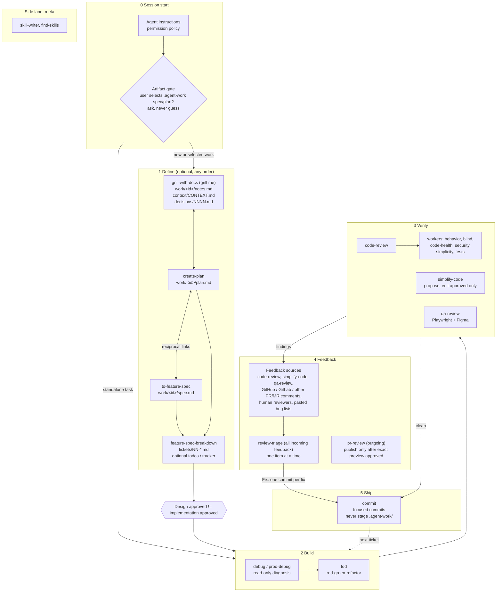

# Agents

Shared agent skills and sub-agent definitions.

## Layout

- `skills/` - [Agent Skills](https://agentskills.io/specification), one directory per skill with a `SKILL.md`.
- `agents/` - sub-agent definitions (Markdown with frontmatter).

## Workflow

How the skills and agents chain together. Define is optional; simple work starts at Build. Every arrow crossing a gate needs explicit user approval. Artifact layout, spec/plan linking and session-start rules: [`docs/work-artifacts.md`](docs/work-artifacts.md).



## Install

Installed by the dotfiles installer (`install-dotfiles`), which clones this repository to `~/Developer/agents` and links it into `~/.agents`:

```bash
mkdir -p ~/.agents/skills
stow -d ~/Developer -t ~/.agents agents
```

`~/.agents/skills` stays a real directory so skills installed with `npx skills` live beside the linked ones without landing in this repository.

## Upstream sources

Each skill's `SOURCES.md` records full provenance, decisions and validation. "Based on" means the local skill adapts that upstream skill; "Pattern reference" means ideas were compared but the skill is a local synthesis. Revisions are the ones last inspected.

| Skill | Based on | Pattern reference |
| --- | --- | --- |
| code-review | Local | [sndrgrdn/pi](https://github.com/sndrgrdn/pi/tree/54b2037a480491d2a7e8eaebd854163e875edad5) `code-review`, `deep-review`, former `thermos`; Google eng-practices; OWASP |
| commit | Local | [getsentry/skills](https://github.com/getsentry/skills/tree/c2f99a5b04b4cd992ec3022d7c2c3e23e938d241) `commit` |
| create-plan | Local | [getsentry/skills](https://github.com/getsentry/skills/tree/c2f99a5b04b4cd992ec3022d7c2c3e23e938d241) `skill-writer` |
| debug | Local | [sndrgrdn/pi](https://github.com/sndrgrdn/pi/tree/54b2037a480491d2a7e8eaebd854163e875edad5) `diagnosing-bugs` |
| feature-spec-breakdown | [mattpocock/skills](https://github.com/mattpocock/skills/tree/9e2abf8611a345efbf779aacb171cff015bcdeb6) `to-tickets` | [sndrgrdn/pi](https://github.com/sndrgrdn/pi/tree/54b2037a480491d2a7e8eaebd854163e875edad5) `to-tickets` |
| find-skills | [vercel-labs/skills](https://github.com/vercel-labs/skills/tree/7407f3893ad4dceab546ac002c3ef806e4000c73) `find-skills` | - |
| grill-with-docs | [mattpocock/skills](https://github.com/mattpocock/skills/tree/c55ee46073ed923f86ce59a5eb3b6d895095d1b7) `grill-with-docs`, `grilling`, `domain-modeling` | - |
| pr-review | Local | [anthropics/claude-plugins-official](https://github.com/anthropics/claude-plugins-official); [feiskyer/claude-code-settings](https://github.com/feiskyer/claude-code-settings/tree/95dab59a62b2031adcb7abf25ae0a60b8a13fdb2) |
| prod-debug | Local | [sndrgrdn/pi](https://github.com/sndrgrdn/pi/tree/54b2037a480491d2a7e8eaebd854163e875edad5) `diagnosing-bugs` |
| qa-review | Local | [microsoft/playwright-mcp](https://github.com/microsoft/playwright-mcp); [vercel-labs/agent-browser](https://github.com/vercel-labs/agent-browser/tree/39a74c70d7759d5a6de7a22c04570bb626bbd081); [microsoft/playwright-cli](https://github.com/microsoft/playwright-cli/tree/b85c7a736bb473bf55b584e54a09ffa698d6d871) |
| review-triage | Local | [obra/superpowers](https://github.com/obra/superpowers/tree/5bf4e78011075bcfc0dc295f0724994cd123ee71) `receiving-code-review` |
| simplify-code | Local ([grugbrain.dev](https://grugbrain.dev/) philosophy) | [getsentry/skills](https://github.com/getsentry/skills/tree/c2f99a5b04b4cd992ec3022d7c2c3e23e938d241) `code-simplifier`; [anthropics/claude-code](https://github.com/anthropics/claude-code/tree/d78be9481b889e11186ec4578b4f5e9301396e25); [mattpocock/skills](https://github.com/mattpocock/skills/tree/c55ee46073ed923f86ce59a5eb3b6d895095d1b7) |
| skill-writer | [getsentry/skills](https://github.com/getsentry/skills/tree/c2f99a5b04b4cd992ec3022d7c2c3e23e938d241) `skill-writer` | [anthropics/skills](https://github.com/anthropics/skills/tree/34040c9c568585f6929bedeaad110ad08f079624) `skill-creator` |
| tdd | [mattpocock/skills](https://github.com/mattpocock/skills/tree/c55ee46073ed923f86ce59a5eb3b6d895095d1b7) `tdd` (inferred) | - |
| to-feature-spec | [mattpocock/skills](https://github.com/mattpocock/skills/tree/c55ee46073ed923f86ce59a5eb3b6d895095d1b7) `to-spec` | [sndrgrdn/pi](https://github.com/sndrgrdn/pi/tree/54b2037a480491d2a7e8eaebd854163e875edad5) `to-spec` |

The `code-review-*` agents descend from the sndrgrdn/pi Thermos workers; the name mapping is in `skills/code-review/SOURCES.md`.

To refresh a skill from upstream, follow `skills/skill-writer/references/upstream-refresh.md` and keep local contracts (approval gates, work-artifact identity, title-only commits) over upstream defaults.
